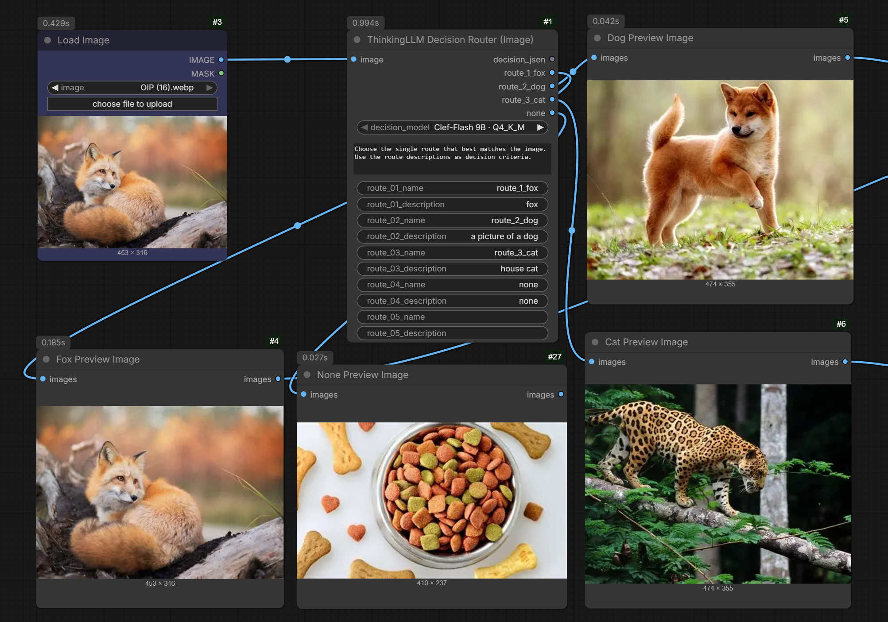

# ComfyUI-ThinkingLLM

**ThinkingLLM** is a multimodal local-LLM node pack for [ComfyUI](https://github.com/comfyanonymous/ComfyUI). It provides workflows for Qwen, Gemma 4, GGUF, Whisper ASR, prompt enhancement, image/video understanding, audio analysis, local image and text decision routing, and secure OpenAI-compatible providers.

[Watch the demo on YouTube](https://youtu.be/K1JsvnzujOw)

> GPL-3.0 fork of Deaquay/ComfyUI-Qwen3.5-Uncensored, itself derived from huchukato/ComfyUI-QwenVL-Mod and 1038lab/ComfyUI-QwenVL. See [LICENSE](LICENSE).

.gif)


## Highlights

- Local Transformers/Hugging Face and GGUF inference
- Image and video understanding with optional mask-focused analysis
- Gemma 4 audio understanding and Whisper speech-to-text
- Prompt enhancers for image and video generation workflows
- Thinking-mode control, live terminal streaming, and a separate `RAW_TRACE` output
- Local image and text decision routing to named, lazily executed workflow branches
- Curated model recommendations and preset-specific generation guidance
- Secure OpenAI-compatible API node for approved remote providers
- Existing compatible models are discovered instead of downloaded twice

## Quick install

### ComfyUI Manager (recommended)

1. Open **ComfyUI Manager** → **Install via Registry**.
2. Search for `ThinkingLLM`.
3. Click **Install** and restart ComfyUI.

### Manual install

```bash
cd ComfyUI/custom_nodes
git clone https://github.com/goodguy1963/ComfyUI-ThinkingLLM.git
cd ComfyUI-ThinkingLLM
pip install -r requirements.txt
```

For GGUF vision or Gemma 4 audio, also follow the [llama.cpp backend installation guide](docs/LLAMA_CPP_PYTHON_VISION_INSTALL.md).

The Decision Router needs native llama.cpp decision APIs that are not present in every `llama-cpp-python` build. Check the [Decision Router runtime guide](docs/LLAMA_CPP_SYSTEMONE_INSTALL.md) before using it; the node checks compatibility but does not replace an already installed native runtime.

## Nodes at a glance

| Node | Backend | Purpose |
| --- | --- | --- |
| `ThinkingLLM` | Transformers / HF | Image and video understanding |
| `ThinkingLLM (Advanced)` | Transformers / HF | Full controls and `MASK_PREVIEW` |
| `ThinkingLLM Prompt Enhancer` | Transformers / HF | Text prompt enhancement |
| `ThinkingLLM (GGUF)` | llama.cpp | GGUF image and video understanding |
| `ThinkingLLM (GGUF Advanced)` | llama.cpp | GGUF advanced controls and `MASK_PREVIEW` |
| `ThinkingLLM Decision Router (Image)` | llama.cpp | Image decisions routed to named branches |
| `ThinkingLLM Decision Router (Text)` | llama.cpp | Text decisions routed to named branches |
| `ThinkingLLM Gemma 4 Audio (GGUF)` | llama.cpp | Gemma 4 audio understanding |
| `ThinkingLLM Whisper ASR` | faster-whisper | Speech-to-text transcription |
| `ThinkingLLM Prompt Enhancer (GGUF)` | llama.cpp | GGUF prompt enhancement |
| `ThinkingLLM System Prompt Preset` | Utility | Reusable system prompts as `STRING` |
| `ThinkingLLM API (OpenAI Compatible)` | Remote API | Approved OpenAI-compatible providers |

The Transformers/HF nodes are the recommended default when you want the simplest installation. Choose GGUF when you specifically need quantized llama.cpp models or Gemma 4 audio.

### Decision Router

The separate Image and Text Decision Router nodes classify their input and send each image or text item to one named route. Configure a system prompt plus route names and descriptions for any task, such as subject, document, or product classification. They offer Clef-Flash 9B, Clef 27B, and OpenJev 27B GGUFs. Model files download on first use into `ComfyUI/models/LLM/GGUF`; image routing also downloads the matching vision projector. Both run in-process without a separate llama.cpp server. Each node exposes up to 52 configured route sockets and returns per-item decisions and normalized route probabilities on `decision_json`. Empty route outputs are blocked, so their downstream branches do not execute. `keep_model_loaded` controls whether the model stays resident between runs (off by default); `include_reason` optionally adds a short post-hoc explanation to each JSON decision without changing the route or scores.

Clef models require llama.cpp's native decision-batch APIs; OpenJev uses llama.cpp's final-position logits API. Image routing additionally requires the MTMD vision APIs; text routing does not. Each node checks the selected capabilities before downloading model weights and reports missing symbols with an installation hint. See [Decision Router llama.cpp requirements](docs/LLAMA_CPP_SYSTEMONE_INSTALL.md) for the runtime details. OpenJev is CC BY-NC 4.0 and is hidden in commercial builds; Clef models are Apache-2.0.



## Start a workflow

1. Add the ThinkingLLM node that matches your backend and task.
2. Select a model or an already installed local model.
3. Connect image, video, audio, mask, or text inputs as needed.
4. Connect `RESPONSE` or `ENHANCED_OUTPUT` to a text display or downstream prompt input.
5. Connect `RAW_TRACE` when you want generation diagnostics.

Useful defaults:

- Start with `enable_thinking=false` for transcription and short direct answers.
- Enable `stream_tokens_to_terminal` when diagnosing a slow or unhelpful generation.
- Resize very large images before inference to reduce context and memory pressure.
- Use the dedicated Gemma 4 Audio or Whisper node instead of assuming every multimodal model supports audio.

For explanations of thinking mode, model guidance, raw traces, audio, masks, and object-removal prompting, see [Features and workflows](docs/FEATURES_AND_WORKFLOWS.md).

## Model families

ThinkingLLM includes curated entries for:

- Qwen3.8, Qwen3.5, Qwen3-VL, Qwen2.5-VL, and Qwen3
- Gemma 4 vision, text, and audio-capable GGUF variants
- Whisper `tiny` through `large-v3` and `distil-large-v3`
- Local compatible Transformers checkpoints and GGUF/mmproj pairs

See [Models and backends](docs/MODELS_AND_BACKENDS.md) for exact families, model locations, local discovery, platform notes, and backend requirements.

## Remote API node

`ThinkingLLM API (OpenAI Compatible)` supports approved OpenAI-compatible providers while keeping credentials on the ComfyUI server. Provider keys are not stored in workflows.

- [API setup, profiles, keys, and security](docs/OPENAI_COMPATIBLE_API.md)
- [API image inputs](docs/OPENAI_COMPATIBLE_API_IMAGES.md)

## Documentation

| Topic | Guide |
| --- | --- |
| Thinking, streaming, traces, audio, masks, and workflow behavior | [Features and workflows](docs/FEATURES_AND_WORKFLOWS.md) |
| Supported models, discovery, locations, and backend selection | [Models and backends](docs/MODELS_AND_BACKENDS.md) |
| GGUF / llama.cpp installation on Windows and Linux | [llama.cpp backend installation](docs/LLAMA_CPP_PYTHON_VISION_INSTALL.md) |
| Decision model runtime requirements | [Decision Router llama.cpp requirements](docs/LLAMA_CPP_SYSTEMONE_INSTALL.md) |
| Duration-aware LTX and MiniMax H3 prompting | [Duration-aware video prompts](docs/VIDEO_PROMPT_DURATION.md) |
| Video preset recommendations and rationale | [Video preset settings](docs/VIDEO_PRESET_SETTINGS.md) |
| OpenAI-compatible API node | [API setup and security](docs/OPENAI_COMPATIBLE_API.md) |
| OpenAI-compatible image inputs | [API image inputs](docs/OPENAI_COMPATIBLE_API_IMAGES.md) |
| Maintainer and fork notes | [Maintainer notes](docs/MAINTAINER_NOTES.md) |

## Production deployment

This repository provides ComfyUI nodes, not a complete production runtime. For exposed or serverless workflows, review dependency locking, validation, secrets, cost controls, monitoring, and rollback before deployment. The [ComfyUI on RunPod production-readiness checklist](https://comfyrail.dev/production-readiness) is a useful starting point.

## Credits

- Deaquay/ComfyUI-Qwen3.5-Uncensored
- huchukato/ComfyUI-QwenVL-Mod
- 1038lab/ComfyUI-QwenVL
- Qwen Team (Alibaba Cloud)
- JamePeng/llama-cpp-python
- comfyanonymous/ComfyUI

Maintainer: [goodguy1963](https://github.com/goodguy1963)

## License

GPL-3.0. See [LICENSE](LICENSE).
